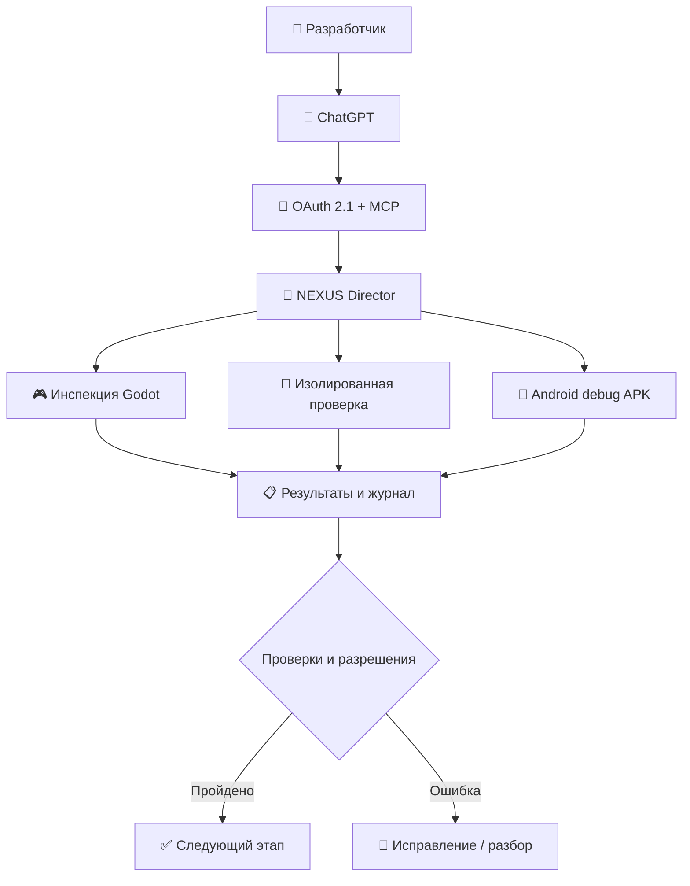

<div align="center">

# ⚡ NEXUS AI

### Центр управления разработкой игр: от идеи до проверенной Android-сборки

**ChatGPT + автономные сценарии + Godot + GitHub + контроль качества**

[](https://github.com/maillunex-lang/nexus-ai)


**Меньше ручной рутины. Больше времени на создание игр.**

[Возможности](#-что-умеет-nexus-ai) · [Как устроено](#-как-это-работает) · [Быстрый старт](#-локальный-запуск) · [Дорожная карта](#-развитие-платформы)

</div>

---

## 🌌 Что такое NEXUS AI?

**NEXUS AI** — открытая платформа для управляемой автоматизации разработки игр. Она соединяет ChatGPT с инструментами разработки через защищённый MCP-интерфейс и помогает организовать процесс: проверить проект, подготовить изменения, провести валидацию, собрать тестовую Android APK и проследить за результатами.

Это не «волшебная кнопка, которая сама создаёт любую AAA-игру». Это **инженерный центр управления**, в котором автоматизация подчиняется проверкам, разрешениям и границам безопасности.

> **Идея:** разработчик задаёт цель, NEXUS помогает провести её через последовательность контролируемых этапов, сохраняя прозрачность действий.

## 🚀 Что умеет NEXUS AI?

| Подсистема | Назначение |
| --- | --- |
| 🧠 **Autonomous Director** | Правиловый директор управляет многоэтапными конвейерами, переходами, проверками и журналом ошибок |
| 🎮 **Godot Validation** | Инспекция проектов Godot и проверка изменений в изолированных копиях |
| 📱 **Android Build Pipeline** | Сборка отладочных APK и выдача краткоживущих подписанных ссылок |
| 🧩 **MCP для ChatGPT** | Защищённые инструменты, доступные через Streamable HTTP |
| 🛡️ **Verification Gate** | Проверки перед переходом к следующему этапу, работа с привязкой к конкретному SHA |
| 👨‍✈️ **Owner Approval Flow** | Контроль согласований и разрешений владельца |
| 🖥️ **Mission Control** | Русскоязычная панель оператора с управлением заданиями, сборками и согласованиями |
| 📚 **Error Journal** | Учёт ошибок и результатов выполнения сценариев |

**Важно:** перечислены возможности, описанные в текущем репозитории. Конкретная доступность сценариев зависит от конфигурации и подключённых инструментов; успешная сборка или прохождение тестов не гарантируются заранее.

## ⚙️ Как это работает



NEXUS разделяет **запрос**, **выполнение**, **проверку** и **подтверждение**. Автоматические переходы не означают неограниченный доступ к серверам или публикацию изменений.

## ✨ Для чего пригодится

- **Инди-разработчику:** повторяемые проверки Godot и подготовка Android-сборок без ручного переключения между инструментами.
- **Небольшой студии:** единая точка наблюдения за заданиями, проверками и результатами.
- **Разработчику с несколькими игровыми проектами:** последовательные сценарии с журналом ошибок и контрольными точками.
- **Создателю собственных AI-инструментов:** пример архитектуры защищённого MCP-сервера с панелью оператора и механизмом согласований.

## 🧱 Технологический стек

| Уровень | Технологии |
| --- | --- |
| Backend | Python, FastAPI, FastMCP |
| Авторизация | OAuth 2.1 Authorization Code + PKCE, scopes `mcp:read` / `mcp:write` |
| Frontend | React 19, Vite |
| Данные | PostgreSQL 16 |
| Game tooling | Godot, изолированная валидация проектов |
| Сборки | Android debug APK |
| Инфраструктура | Docker Compose, GitHub Actions |

## 🏁 Локальный запуск

> [!WARNING]
> **Не выставляйте экземпляр для разработки в публичный интернет.** Перед развёртыванием изучите ограничения безопасности и настройте авторизацию. Эти команды предназначены для локальной среды, не для рабочего VPS.

1. Скопируйте `.env.example` в `.env`.
2. Укажите уникальные `POSTGRES_PASSWORD` и `NEXUS_MCP_INTERNAL_TOKEN` (не менее 48 случайных символов). Специальные символы в пароле БД внутри URI требуют кодирования.
3. Запустите:

```bash
docker compose up --build -d
```

4. Откройте `http://127.0.0.1:4189` на той же машине.
5. Для остановки без удаления тома базы данных:

```bash
docker compose down
```

### Миграции базы данных

`db/001_initial.sql` применяется только при первом создании тома PostgreSQL. Для существующей установки сначала создайте резервную копию базы, затем **один раз** примените `db/002_identity.sql` через `psql -v ON_ERROR_STOP=1`. Сейчас это ручные SQL-скрипты, а не полноценный миграционный механизм.

## 🧪 Проверки

**Backend:**

```bash
python -m pip install -r backend/requirements-dev.txt
PYTHONPATH=backend python -m pytest -q backend/tests
```

**Frontend:**

```bash
cd frontend
npm install
npm run build
```

В репозитории предусмотрены GitHub Actions для тестов backend и сборки frontend. Команды приведены для воспроизведения проверок, а не как заявление об их текущем успешном прохождении.

## 🔐 Безопасность прежде всего

- OAuth 2.1 с PKCE, явным согласием и разграничением `mcp:read` / `mcp:write`.
- MCP endpoint `/mcp/` защищён fail-closed bearer guard.
- Внутренний bearer-токен отключается при заданном `NEXUS_OAUTH_ISSUER`.
- Детерминированный Director **не вызывает LLM, не запускает shell-команды и не публикует изменения**.
- Исходные каталоги игр доступны Director только для чтения; проверки изменений выполняются в изолированных копиях.

**Известные ограничения:** пока нет отдельного CSRF-токена на сессию (используются проверки Origin и Fetch Metadata), rate limiting ограничен, журналирование событий аутентификации неполное. Подробности: [Security Audit](docs/SECURITY_AUDIT_2026-11-12.md).

## 🗺️ Развитие платформы

NEXUS AI развивается как модульная экосистема автоматизации разработки. Среди направлений для дальнейшей работы: расширение игровых конвейеров, более глубокие проверки качества, улучшение контроля задач, интеграции с инструментами создания контента и повышение надёжности.

**Планы не следует путать с готовыми функциями.** Актуальные подтверждённые результаты, проблемы и следующие шаги:

- [Аудит и дорожная карта от 13.11.2026](docs/AUDIT_AND_ROADMAP_2026-11-13.md)
- [Autonomous Director 0.6](docs/AUTONOMOUS_DIRECTOR_0.6.md)
- [Enterprise Roadmap](docs/ENTERPRISE_ROADMAP.md)

## 🤝 Участие в проекте

Нашли ошибку или придумали полезную интеграцию? Откройте Issue с описанием сценария, ожидаемым поведением, шагами воспроизведения и логами **без секретов и токенов**.

---

<div align="center">

### ⚡ NEXUS AI

**Не просто выполнять команды. Строить управляемый процесс создания игр.**

[GitHub Repository](https://github.com/maillunex-lang/nexus-ai)

</div>
